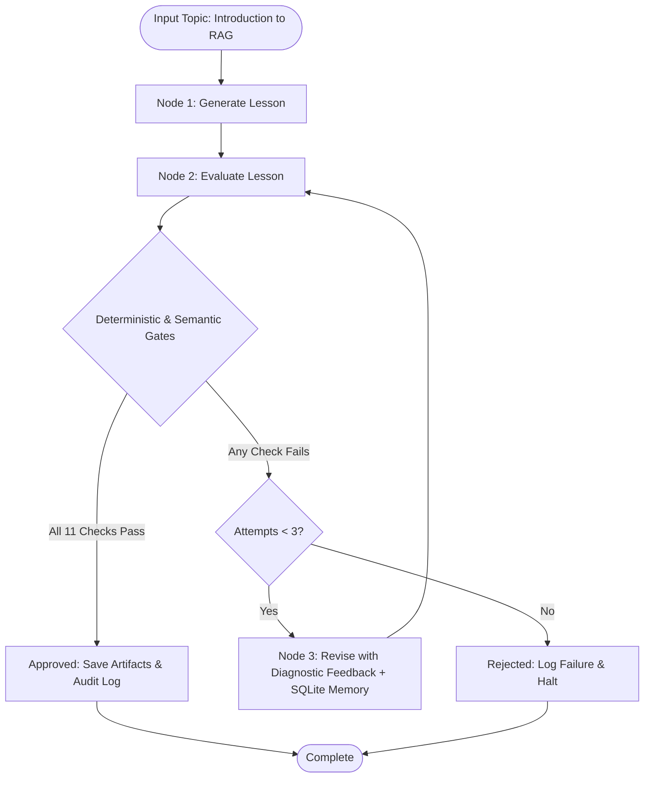

# LearnLoop ✳
> **Better lessons. Proven by evaluation.**  
> An agentic educational content generator with deterministic guardrails, structured semantic evaluation, bounded self-correction loops, and persistent failure memory.

---

## 📋 Executive Summary

Built for the **Associate GenAI Engineer – Content Systems** assessment at **NxtWave**.

Standard LLM content pipelines rely on single-turn generation, assuming that what the model produces is ready for publication. In educational systems—particularly for beginner learners—this approach fails silently through hallucinated facts, unexplained jargon, and inappropriate language levels.

**LearnLoop** approaches educational generation as an autonomous quality-assurance pipeline:
1. **Generates** a standalone beginner lesson grounded strictly in a verified knowledge source.
2. **Evaluates** the draft against 11 binary pass/fail quality gates (3 deterministic code checks + 8 semantic rubric checks).
3. **Rejects** content if even one criterion fails.
4. **Revises** defective drafts using structured feedback and historical failure memory within a bounded retry loop (max 3 total attempts).
5. **Approves & Persists** only lessons that clear 100% of the rubric gates.

---

## 🎯 Target Learner Persona

- **Audience:** Indian Class 12 graduates from non-English-medium backgrounds entering AI.
- **Language Level:** CEFR A2/B1 level. Short, direct sentences (max 15–18 words).
- **Pedagogical Strategy:** Relatable everyday Indian analogies (Open-Book vs. Closed-Book exams), immediate layperson definitions for technical terms, concrete Indian context examples (college admissions), and explicit discussion of real-world limitations.

---

## 🏗️ System Architecture & Workflow



### The Dual-Layer Evaluation Engine

#### 1. Deterministic Guardrails (Zero-Token Code Checks)
- **D1 (Length Check):** Verifies word count is strictly between 400 and 1,300 words to ensure adequate depth without cognitive overload.
- **D2 (Misconception Scanner):** A **negation-aware regex engine** that catches the false claim that RAG permanently retrains or modifies language model weights. Using a 60-character lookback window, it avoids false positives when a lesson correctly explains: *"RAG does NOT permanently train the language model."*
- **D3 (Structural Anchor Check):** Ensures foundational pedagogical sections are present (Objectives, Explanation, Example, Limitations, Key Terms, Knowledge Check).

#### 2. Semantic Quality Rubric (Gemini + Pydantic Schema)
- **Q1 (Factual Accuracy):** All technical explanations are factually correct.
- **Q2 (Source Grounding):** Claims strictly align with `knowledge/rag_sources.md`.
- **Q3 (Beginner Readability):** Sentence length and vocabulary suit an Indian Class 12 graduate.
- **Q4 (Jargon Explanation):** Terms (*chunks*, *embeddings*, *vector database*) are explained in simple language immediately on first use.
- **Q5 (Practical Example):** Realistic, relatable scenario demonstrating the entire workflow.
- **Q6 (Core Coverage):** Explains What RAG is, Why it is used, its Components, and Step-by-Step Flow.
- **Q7 (Limitations):** Acknowledges latency, bad source notes, and that RAG is not 100% error-free.
- **Q8 (Standalone Structure):** Self-contained, logical sequence requiring no external instructor.

#### 3. Deterministic Approval Integrity
Approval is calculated strictly in Python:

```python
approved = all(check["status"] == "PASS" for check in all_checks) and len(all_checks) == 11
```

The model's own evaluation summary is never trusted as the source of truth. If parsing fails, the system **fails closed**.

---

## 🔁 Persistent Failure Memory

- **Database:** Local SQLite store (`memory/learnloop.db`).
- **Mechanism:** Every evaluation run, attempt count, pass/fail status, and diagnostic reason is logged. When a revision is triggered, `recent_failures(topic)` queries prior failures and injects targeted remediation warnings into the revision prompt, preventing the generator from repeating past errors.

---

## 📁 Repository Structure

```text
LearnLoop/
├── app.py                     # Streamlit web application with Linear-inspired dark UI
├── engine.py                  # LangGraph state machine, nodes, guardrails & execution loop
├── config.py                  # Configuration loader (API keys, model parameters)
├── smoke_test.py              # Gemini connection verification script
├── evaluation/
│   └── rubric.py              # Rubric criteria & Pydantic output validation schema
├── memory/
│   ├── store.py               # SQLite storage logic for evaluations & lessons
│   └── learnloop.db           # SQLite database file
├── knowledge/
│   └── rag_sources.md         # Source of truth knowledge pack on RAG
├── artifacts/
│   ├── lessons/               # Exported Markdown lessons (approved & rejected)
│   └── evaluation_logs/       # Exported JSON evaluation audit logs
├── tests/
│   └── test_pipeline.py       # Automated unit test suite (Mocked Gemini)
├── requirements.txt           # Project dependencies
├── .env.example               # Environment variable template
└── README.md                  # Comprehensive documentation
```

---

## 🚀 Setup & Local Installation

### Prerequisites
- Python 3.11 or 3.12
- Google Gemini API key

### 1. Clone & Setup Virtual Environment
```powershell
git clone <your-repository-url>
cd LearnLoop

# Create virtual environment
python -m venv .venv

# Activate virtual environment (Windows PowerShell)
.venv\Scripts\activate

# Install dependencies
pip install -r requirements.txt
```

### 2. Configure Environment Variables
Create a `.env` file in the project root:
```env
GEMINI_API_KEY=your_actual_api_key_here
GEMINI_MODEL=gemini-3.5-flash-lite
```

### 3. Run Automated Tests
```powershell
python -m pytest tests\test_pipeline.py -v
```

### 4. Launch the Web Interface
```powershell
streamlit run app.py
```
Open your browser at `http://localhost:8501`.

---

## 🧪 Deliberate Failure (Stress-Test) Demonstration

1. In the web dashboard, check **"Enable evaluator stress test"**.
2. Click **"✳ Generate and evaluate lesson"**.
3. **Attempt 1:** Injects the false claim: *"Whenever RAG retrieves a document, it permanently trains the language model on that document."*
4. **Evaluation 1:** Caught by **D2** (Misconception check) and **Q1** (Factual accuracy) $\rightarrow$ Marked **REJECTED**.
5. **Revision Node (Attempt 2):** Ingests the rejection reasons, removes the false claim, rewrites the lesson, and passes all 11 gates on Attempt 2 $\rightarrow$ Marked **APPROVED**.
6. The entire audit trail is preserved under the **Revision history** tab and saved to `artifacts/evaluation_logs/`.

---

## ⚖️ Engineering Trade-Offs & Future Roadmap

- **Latency vs. Cost:** Using `gemini-3.5-flash-lite` provides rapid revision iterations with low latency and negligible token cost.
- **Fail-Closed Design:** Any malformed evaluator output triggers an immediate FAIL verdict across all criteria rather than silently passing unverified text.
- **Future Enhancements:**
  - Automated escalation to a human editorial queue when a lesson exhausts 3 attempts without passing.
  - Upgrading SQLite to PostgreSQL with vector similarity search over historical rejection logs.
  - Multi-modal asset generation (automated diagrams and flashcards for visual learners).